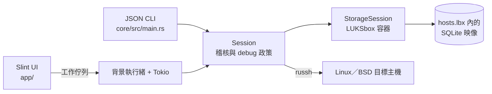

# MISF Management Terminal 架構

> 最後修改：2026-11-10 ｜ 基於 commit：`2e87553`

> [!WARNING]
> **本專案仍處於開發階段，請勿用於正式環境。** 相關安全保護機制尚未完善。
>
> 目前只有 **APT**（Debian／Ubuntu）在真實主機上測試過。DNF、YUM、pkg 等其他功能只通過 loopback 模擬伺服器的自動測試，不保證可用或安全。

本文件描述目前的實作；每個 `.rs` 檔案的職責見 [原始碼檔案說明](PROJECT-DEV-ARCH.md)。建置、慣例與測試指令見 [開發說明](PROJECT-DEV.md)，加密容器的取捨見 [LUKSbox 加密儲存設計](luksbox-design.md)。

## 概觀

單一桌面執行檔：Slint（fluent 樣式、winit 視窗、Skia 繪製）顯示原生視窗，直接呼叫同一程序內的 Rust 核心。沒有管理伺服器、HTTP 服務、TOKEN 或遠端資料庫。SSH 使用內建的 russh，不執行系統 `ssh`，也不讀取本機 SSH config、known_hosts、agent 或系統私鑰。

## 程式結構

| 位置 | 職責 |
| --- | --- |
| `app/ui/*.slint` | 畫面宣告：主視窗外框、側欄、主機頁、結果分頁、批次表格、設定視窗與各對話框；每頁以一個 Slint global 接收資料與送出操作 |
| `app/src/ui/` | 視窗狀態 `App` 與各頁模組：把狀態填入對應的 Slint global，並處理該頁的操作 |
| `app/src/session_log.rs` | 只存在記憶體的工作階段 LOG，可在設定中匯出 |
| `app/src/worker.rs` | 把請求交給背景執行緒與 Tokio runtime，回傳進度與結果；批次中轉送每台結果與失敗詢問 |
| `app/src/preferences.rs` | 未加密的 `ui-settings.json`（語言、外觀、清單與批次表格偏好、自動鎖定分鐘數） |
| `app/src/i18n.rs`、`app/locales/` | 內嵌的 zh-tw／en-us 語系，以穩定 key 與命名參數取字 |
| `app/src/theme.rs` | 淺色／深色／跟隨系統的外觀選項（配色在 `app/ui/theme.slint`） |
| `core/src/lib.rs` | 主機請求的分派（下表） |
| `core/src/batch.rs` | 批次作業：並行、逐台儲存與回報、失敗時暫停詢問 |
| `core/src/reboot.rs` | 重新開機：固定命令 `shutdown -r +1`，只限 APT 主機 |
| `core/src/session.rs` | GUI 與 CLI 共用的入口：寫稽核日誌、套用 debug 限制，再交給 StorageSession |
| `core/src/vault.rs` | `StorageSession`：容器建立、解鎖、金鑰槽、備份、舊版明文轉入與刪除 |
| `core/src/passkey.rs`、`core/src/windows_passkey.rs` | FIDO2／Windows WebAuthn 解鎖 |
| `core/src/store.rs`、`core/src/sqlite.rs`、`core/src/db_upgrade/` | 資料模型的讀寫、SQLite 強化與結構遷移 |
| `core/src/ssh.rs`、`core/src/transcript.rs` | SSH 傳輸：主機指紋、認證、執行單一命令（含 sudo 提示）、測試連線；輸出清理與 `heading` 區段標題框 |
| `core/src/package_manager/` | 套件管理：`mod.rs`（`Manager` 與分派）、`detect.rs`（系統偵測）、`operation.rs`（檢查／升級／dist-upgrade 流程）、`apt.rs`、`dnf.rs`、`yum.rs`、`pkg.rs`（各自的固定命令、失敗判斷與解析）、`rpm.rs`（DNF／YUM 共用的清單解析） |
| `core/src/model.rs` | `Host`、`SshKey`、`HostGroup`、`CheckResult`、`UpgradePlan`、`RestartStatus`、`ConnectionTest` |
| `core/src/audit.rs`、`core/src/runtime.rs` | 操作日誌；資料目錄與 `--debug.*` 參數 |

## 請求協定

UI 與 CLI 都送出 `{"action": …}` JSON 給 `Session::handle`。CLI 從 stdin 讀一個請求或請求陣列（上限 8 MiB，以 zeroize 緩衝），依序執行，輸出 `progress`／`result`／`error` 行；容器解鎖狀態只存在該程序內，密碼不放命令列。

- **儲存**：`storage_status`、`vault_create`、`vault_unlock`、`vault_unlock_passkey`、`vault_lock`、`vault_upgrade`、`vault_upgrade_cancel`、`vault_add_key`、`vault_add_passkey`、`vault_rename_key`、`vault_revoke_key`、`vault_backup`、`vault_delete_plaintext`。
- **主機資料**（需已解鎖）：`list`、`save`、`delete`、`convert_storage`、`key_add`、`key_delete`、`group_add`、`group_rename`、`group_collapse`、`group_delete`、`arrange`。
- **遠端**：`probe`、`trust`、`test`、`check`、`upgrade`、`batch`、`reboot`。

## 主機、金鑰與分類

主機保存名稱、位址、埠、帳號、備註、認證方式與 sudo 密碼。認證為密碼，或 OpenSSH／PEM 私鑰加私鑰密語；只支援 Ed25519 與 ECDSA（nistp256／384／521），RSA 在匯入與連線時拒絕（原因見[依賴更新](dependency-updates.md#不支援-rsa)）。私鑰可存成共用金鑰（`ssh_keys`），主機以 `key_id` 引用，連線時由核心填入；UI 只收到名稱、演算法與指紋。仍被引用的金鑰不能刪除。

側欄分類由 `group_*` 動作管理；刪除分類只把主機改回未分類。拖曳後 UI 先即時顯示，再送出 `arrange`，帶齊全部分類 ID 與每台主機的 `{id, group_id}` 順序；兩份清單必須與主機庫完全一致，否則整筆拒絕並重新載入。

`save` 一律沿用伺服器端的偵測結果、信任指紋、檢查結果與連線資訊；位址或埠變更時清除這些資料。

## SSH 連線

- **主機指紋**：`probe` 只取 SHA-256 指紋，`trust` 由使用者確認後保存。未確認前不送出帳密；指紋不同立即中止，不嘗試認證。
- **錯誤**：沒有共同主機金鑰演算法時（例如只提供 RSA 主機金鑰），顯示需啟用 Ed25519／ECDSA 的說明。錯誤訊息經 `Host::redact` 遮蔽已知密碼與位址片段。
- **連線資訊**：`test` 每次產生一筆 `ConnectionTest`（成功、失敗都存，每台只留最後一次），來源為 `check_server_key`、`client::Handler::kex_done` 與認證結果：伺服器版本（移除控制字元、最多 255 字）、金鑰交換、主機金鑰演算法與指紋、加密演算法、雙向 MAC（AEAD 為 `none`）、是否啟用嚴格金鑰交換、登入方式與用戶端公鑰演算法／指紋，以及核心、發行版與可用套件管理器。不含密碼、私鑰或遠端輸出。UI 在結果卡片的「連線資訊」分頁顯示，失敗時重新載入清單以顯示部分結果。
- **sudo**：一般帳號以 `sudo -S` 執行，密碼經 channel stdin 傳送且每個 channel 最多送一次；PTY 預設開啟。連線每 30 秒送 keepalive。

## 系統偵測與套件管理

每個套件管理器一個檔案，命令一律是 `&'static str` 常數，不把主機紀錄中的任何值插入命令；確認視窗顯示的就是實際執行的字串。`Manager` 以 `match` 分派，新增套件管理器時編譯器會要求補齊每個操作。測試確認 root 命令不含 sudo、一般帳號的命令都使用相同的 `sudo -S -p` 提示標記。

每次測試、檢查或升級先以 `sh -c` 執行 `uname -s`／`uname -r`、讀取 `/etc/os-release` 的 NAME／VERSION_ID（例如「Debian 13」「Ubuntu 26.04」），並列出可用的 apt、dnf、yum 與已初始化的 pkg。Linux 依 APT → DNF → YUM 選擇，FreeBSD／DragonFly 用 pkg，其餘只支援連線測試。使用者可在主機上指定套件管理器（`manager_choice`），但它必須確實存在。主機已有偵測紀錄時，執行時偵測結果不同即失敗，不執行套件命令，因為確認視窗顯示的是紀錄中的命令。

| 管理器 | 檢查 | 升級 | 實機測試 |
| --- | --- | --- | --- |
| APT | `apt-get -q=1 update`，再以英文 locale 列出待更新套件 | `apt-get -y upgrade`（`DEBIAN_FRONTEND=noninteractive`、`NEEDRESTART_MODE=l`、`--force-confdef --force-confold`）；另有使用者明確選擇的 `dist-upgrade`（相同參數） | upgrade 已測試；dist-upgrade 未實機測試 |
| DNF／YUM | `makecache`，再 `check-update -C` 並輸出 `rpm -qa` 版本；退出碼 0／100 為成功 | `-y upgrade` | 未測試 |
| pkg | `pkg update`，`pkg version -URv -l '<'` | `pkg upgrade -y` | 未測試 |

- 索引更新失敗不讀套件清單，也不開始升級。APT 輸出含 `E:`、DNF／YUM 含 `Error:`／`Failed to download metadata`／`Ignoring repositories`，或非零退出碼，即為失敗；升級失敗時提示遠端可能已部分升級。索引更新上限 5 分鐘，升級上限 30 分鐘。
- 升級前後各讀一次待更新清單：`CheckResult.upgraded` 為升級後消失的套件，`packages` 為剩餘套件，`operation` 為 `check`／`upgrade`／`dist_upgrade`。APT 的 phasing 延後套件與 kept back 套件在載入時從保存的升級輸出解析，不另存欄位。
- 輸出統一換行、移除 ANSI 與終端控制字串後保存，UI 以可選取的等寬文字顯示。每個步驟以 `transcript::heading` 產生的星號框標題分段（更新套件索引、待更新套件、APT upgrade、dist-upgrade 模擬、重新啟動狀態），框寬依標題的顯示寬度（中文算兩格）。每台主機只保存最近一次檢查或升級。

### Kept back 與 dist-upgrade（只限 APT）

- `apt-get upgrade` 不安裝新套件也不移除套件，所以需要新套件的更新（例如核心的 `linux-generic` 需要新的 `linux-image-*`）會被列在「The following packages have been kept back:」，退出碼仍為 0。MISF 解析這份清單存入 `CheckResult.kept_back`（扣除 phasing 延後的套件）。
- 有 kept back 時，接著執行唯讀的 `apt::SIMULATE`（`apt-get -s dist-upgrade`，不取鎖、不需 sudo、不變更系統），解析 `Inst`／`Remv` 行為 `UpgradePlan`：新安裝、升級（舊→新版本）與移除。模擬失敗只讓 `plan` 為空。
- 操作結束時（單台升級或整個批次結束後），UI 彈出報告，列出需要 dist-upgrade 的主機、被保留的套件與模擬出的變動，並可直接對這些主機開啟 dist-upgrade 確認。
- `dist_upgrade` 請求（單台與批次 `operation: "dist_upgrade"`）只有 APT 有命令，其他套件管理器在任何套件命令前就失敗。確認視窗列出實際命令、較強的風險說明，以及各主機上次模擬的新裝／升級／移除數量與將移除的套件。稽核動作為 `dist_upgrade`、`batch_dist_upgrade`。

### 重啟提示與重新開機（只限 APT）

- **不解析升級輸出**：needrestart 在升級時印出的文字是給人看的，格式會隨版本與設定改變，也只在 MISF 升級時才出現。改為在檢查或升級成功讀完清單後，另外執行固定、唯讀的 `apt::STATUS`：讀 `/var/run/reboot-required`（與 `.pkgs`），再以 `needrestart -r l -b`（只列出、機器可讀格式）取得目前／預期核心（`KSTA` ≥ 2 視為需要重新開機）、需要重啟的服務、容器與使用者工作階段。沒有 needrestart 時只回報 reboot-required，服務清單標示為未知而不是「沒有」。
- **與 update／upgrade 相同的 sudo 機制**：root 直接執行 `apt::STATUS`；一般帳號執行 `apt::SUDO_STATUS`，整段 `sh -c` 放在 `sudo -S -p` 裡跑，sudo 密碼同樣經 channel stdin 傳送。needrestart 以 root 身分掃描所有行程，主機需保持更新（舊版有 CVE-2024-48990 等本機提權漏洞）。這條命令列在確認視窗的命令清單中。
- **不影響主結果**：讀取失敗或逾時（2 分鐘）只讓 `CheckResult.restart` 為空，檢查／升級仍算成功；原始輸出附在執行輸出的「重新啟動狀態」段落。
- **永不自動重啟服務**：升級命令固定帶 `NEEDRESTART_MODE=l`，MISF 不提供重啟個別服務的功能（那需要把服務名稱組進命令）。UI 只顯示需要重啟的項目：主機頁的警示列、結果卡片的「重啟提示」分頁與批次表格的「重啟提示」欄。
- **重新開機**：`{"action":"reboot","id":…}` 只接受已偵測為 APT 的主機，執行固定命令 `shutdown -r +1`（root 直接執行，一般帳號經 `sudo -S`），1 分鐘後才重開，主機上可用 `shutdown -c` 取消，SSH 命令也能正常結束。UI 需兩次確認：第一個視窗列出命令與風險並要求勾選，第二個視窗再問一次主機名稱與位址。稽核記錄 `reboot`、`reboot_prompt`、`reboot_cancel`；debug 模式只允許 loopback 主機。

## 批次作業

`{"action":"batch","operation":"check"|"upgrade","ids":[…]}` 去除重複 ID 後讀取主機快照，最多 256 台，以 Tokio JoinSet 最多 8 台並行。任何 ID 不存在、套件管理器未偵測或彼此不同時整批拒絕。

每台主機一完成就寫回主機庫，再透過 `batch::Observer::finished` 回報；中途關閉程式也保留已完成的主機。某台結果不是 `success`（含工作異常結束，記為失敗）時呼叫 `Observer::failed`，在得到 `Decision` 之前不開始新主機，但已在執行的主機繼續跑完並照常儲存與回報；等待期間的其他失敗排隊依序詢問。`Abort` 後不再開始任何主機，已在執行的不會中途停止（可能正在安裝套件），回應的 `skipped` 列出未執行的主機 ID，稽核日誌記為 `cancelled`。某台結果無法儲存時同樣停止開始新主機，等執行中的跑完後回傳錯誤。

GUI 的 worker 把 `finished` 轉成即時更新表格列、把 `failed` 轉成無法略過的視窗（「中斷批次作業」／「繼續其他主機」）；視窗關閉或程式結束時視為中斷。CLI 與 `dispatch` 使用 `batch::Unattended`：不回報、遇到失敗一律繼續。UI 依套件管理器分組，只能勾選同一組中已確認指紋的主機；升級前顯示主機清單、實際命令與風險，並要求勾選確認。

## 本機儲存

資料目錄預設為使用者目錄的 `.misf-management/`，可用 `MISF_DATA_DIR` 或 `--debug.dir` 改變：

| 檔案 | 內容 | 加密 |
| --- | --- | --- |
| `hosts.lbx`（另有 `.header-bak`／`.meta-bak` 復原鏡像） | 主機庫 | 是 |
| `hosts.lbx.enabled` | 已建立容器的標記，不含資料 | 否 |
| `ui-settings.json` | 語言、外觀、視窗與清單偏好，不含憑證 | 否 |
| `logs/actions-YYYY-MM-DD.jsonl` | 操作日誌 | 否 |

### StorageSession

主機庫一律為 LUKSbox 容器，沒有未加密模式。沒有 `hosts.lbx`／`hosts.lbx.enabled` 時狀態為未建立且鎖定，除儲存動作外一律拒絕；鎖定、錯誤密碼、容器損壞或遺失時也不會改讀明文。解鎖狀態與金鑰保存在背景 worker 的 `StorageSession`，不在每次請求重建。

- **建立**：`vault_create` 先檢查新密碼（至少 8 字元，含數字、字母、符號其中兩種，空白只計長度；`vault::passphrase_problem`，GUI 與核心各檢查一次）。資料直接從記憶體寫入暫存容器，關閉後以密碼重新解鎖並比對，通過才放到正式路徑。
- **舊版明文轉入**：同目錄有舊版 `hosts.db`（或更早的 `hosts.json`）時，以 `hosts.lock` 跨程序互斥讀出後轉入容器，原檔保留。全新設定檔不寫出任何明文檔。
- **刪除明文副本**：GUI 啟動與解鎖後若發現上述檔案，顯示完整路徑並詢問。`vault_delete_plaintext` 要求已解鎖、明確確認及完全相同的絕對路徑，先驗證容器、取得明文資料鎖，拒絕非一般檔案、symlink 與 Windows reparse point，只刪除該檔（`hosts.db` 連同 `-journal`）。這不是安全抹除。
- **儲存**：每次在記憶體建立全新 SQLite 資料庫並序列化（不殘留已刪除的列），寫入新 VFS inode 後 rename，於單一中繼資料提交取代 `/hosts.db`。容器內若仍是舊格式 `/hosts.json`，讀取時轉換，下一次儲存（或 `convert_storage`）在同一提交中換成 `/hosts.db`。

### SQLite

使用 rusqlite 的 bundled SQLite（靜態連結，未編入 load_extension）。容器內映像以 `sqlite3_deserialize` 在記憶體開啟；讀取舊版明文 `hosts.db` 時套用相同檢查：

1. 開檔前拒絕 WAL：旁邊有 `-wal`／`-shm`，或檔頭讀寫格式不是 rollback journal，就不交給 SQLite。
2. 強化連線：DEFENSIVE、關閉 trusted_schema、停用 trigger／view、ATTACH 上限 0、secure_delete、temp_store=MEMORY、mmap_size=0、cell_size_check。
3. `quick_check`，核對 `application_id`（`0x4D495346`，"MISF"）與 `user_version`，再把 `sqlite_schema` 與同版本遷移在記憶體重建的參考結構逐列比對；多出的 trigger、view、index 或改過的欄位定義都拒絕。

所有 SQL 為固定語句與綁定參數。資料表（皆為 STRICT，清單以 `position` 保留順序）：

| 資料表 | 內容 |
| --- | --- |
| `hosts` | 主機欄位，含 `manager_choice`、`key_id`、`group_id`（空字串表示自動偵測／主機自帶私鑰／未分類） |
| `check_results`、`packages` | 每台主機最近一次檢查或升級，及其套件清單 |
| `ssh_keys` | 共用 SSH 金鑰 |
| `host_groups` | 側欄分類名稱、順序與收合狀態 |
| `key_slots` | LUKSbox 金鑰槽名稱 |
| `connection_tests` | 每台主機最後一次測試連線（`package_managers` 以逗號分隔），隨主機刪除 |
| `restart_status`、`restart_items` | 最近一次檢查或升級讀到的重啟狀態；`restart_items.kind` 為 `package`／`service`／`container`／`session`，隨檢查結果刪除 |

目前結構版本為 v6。遷移每一步一個檔案（`core/src/db_upgrade/vN_vM.rs`），`MIGRATIONS[n]` 把 vN 升到 vN+1，依序串接；新增版本只追加檔案，已發布的步驟不得修改。版本較新時拒絕開啟，不降級寫入。明文 `hosts.db` 遷移前先複製為 `hosts.v<N>.bak.db`，再於單一交易執行。容器內資料庫較舊時主機庫維持鎖定（`pending_upgrade`）並詢問：`vault_upgrade` 寫回目前版本，`vault_upgrade_cancel` 關閉容器、檔案不變。

### LUKSbox 容器與 Passkey

使用 LUKSbox v0.6.1 固定 commit 的 core／format／VFS（AES-256-GCM-SIV、Argon2id 256 MiB／t=3／p=4），以函式庫直接讀寫，不掛載磁碟。密碼與 Passkey 合計最多 8 個金鑰槽，可命名、撤銷（不能撤銷最後一槽）與匯出加密備份；備份經現有 Container handle 複製密文，不覆寫既有檔案。

Passkey 只使用 `Fido2HmacSecret` 包裝槽。Windows 透過 `windows_passkey.rs` 呼叫 webauthn.dll（Hello 或外接安全金鑰），每次使用新的 32-byte challenge 與合法 client JSON，依 API 版本選擇 options 並保持 UV Required；Linux 透過 libfido2 與當次 PIN 操作 CTAP2 裝置。註冊後兩次讀取 PRF 一致才寫入 header；credential ID 與 salt 隨槽保存，PIN 與 PRF 不落地，PRF 放入 zeroizing 容器。

## 操作日誌與 debug 模式

`core/src/audit.rs` 只接受固定的動作／結果列舉、可選的主機顯示名稱與槽號，不接受原始請求或錯誤字串；以程序內互斥與跨程序檔案鎖追加 UTC 每日 JSONL 並同步磁碟。開始紀錄寫入失敗時不執行操作；結果無法記錄時明確告知狀態可能已改變。日誌沒有防竄改或自動清理。

工作階段 LOG（`app/src/session_log.rs`）是刻意完整的紀錄，只存在記憶體、關閉程式即消失，在「設定 > LOG」匯出成明文文字檔。每次遠端操作（批次、檢查、升級、測試連線、指紋、重新開機）先寫一段以 `********` 框起的標題，例如「使用者 進行批次 APT 升級（3 台）」；每台主機的結果是一個區塊，從主機名稱開始、到 `END OF <主機名稱>` 結束，內含主機 ID、帳號@位址:埠、主機指紋、系統、待更新／已升級套件、重啟狀態、錯誤與遠端原始輸出（核心只替換其中的密碼，並移除終端控制字元）。其餘請求與回應完整記錄。只有名為 `password`、`sudo_password`、`key_passphrase`、`passphrase`、`private_key`、`pin` 的欄位在任何層級一律遮蔽；回應中的 `output` 改記長度，避免與主機區塊重複。超過 16 MiB 時捨棄最舊的紀錄；匯出寫入 `log_export` 稽核紀錄。

`RuntimePaths` 在啟動時解析 `--debug.dir`，以明確路徑注入偏好、日誌與 worker，不修改程序環境，失敗不回退正式資料。debug 模式只允許 loopback IP 的 SSH、禁止真實 Passkey 操作、備份限於測試目錄，UI 持續顯示 DEBUG。`--debug.allow-passkey` 須與 `--debug.dir` 同時使用，才開放實體驗證器，SSH 與備份限制不變。

## 介面與背景工作

UI 把請求放入工作佇列，由背景執行緒與 Tokio runtime 執行 SSH 與磁碟操作，期間停用衝突操作。關閉程式會結束本機連線，但不能保證中止遠端已開始的套件程序。「設定」視窗以左側分類樹集中語言、外觀、偏好（再分為外觀與主機清單、安全性、批次作業）與 LUKSbox 管理，並顯示程式版本（Cargo 套件版本）、主機庫格式與結構版本；容器內仍為 JSON 時提供「轉換為 SQLite 資料庫」（`convert_storage`）。偏好存在 `ui-settings.json`，以暫存檔原子替換，主機庫鎖定時也能讀寫。自動鎖定（`auto_lock_minutes`，1～1440，預設不啟用）由 UI 計算閒置時間：只有滑鼠、鍵盤、捲動、貼上等使用者輸入會重新計時，worker 忙碌時也重新計時以免中斷作業；時間到時 UI 先清除主機快取與相關視窗，再送出 `vault_lock`，稽核記為 `vault_auto_lock`。

## 測試與限制

- 整合測試在 loopback 啟動測試 SSH 伺服器，涵蓋密碼／私鑰、指紋、連線資訊、PTY、拆包的 sudo 提示、系統偵測、APT 與 DNF 檢查／升級、套件管理器不符、混合批次、失敗處理與儲存流程；不接觸真實主機。
- 儲存測試涵蓋未建立容器時拒絕、轉入保留原檔、鎖定與錯誤密碼、多金鑰槽、備份、密文篡改、並行開啟、WAL 與結構竄改拒絕。Passkey 以模擬驗證器測試，實體裝置依 [Passkey 實體測試](passkey-testing.md) 驗證。
- 實機只測試過 APT；YUM 與 pkg 只有輸出解析的單元測試。
- 不支援 full-upgrade、任意命令、互動終端、排程、滾動升級或 Ansible；沒有原地改密碼、主金鑰輪替或 TPM。
