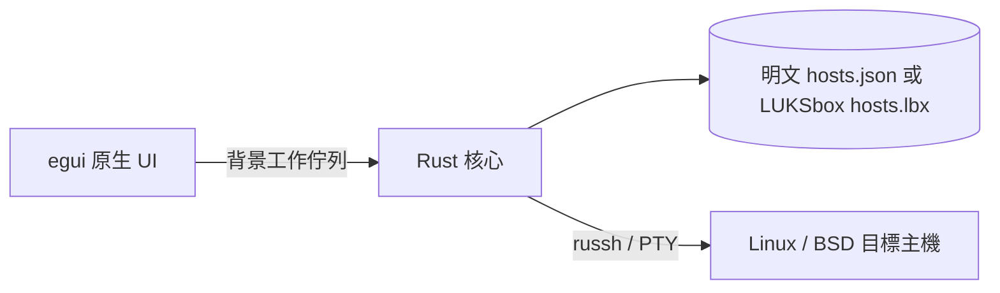

# MISF Management Terminal：全 Rust 原生桌面

> [!WARNING]
> **本專案仍處於開發階段，請勿用於正式環境。**
> 相關安全保護機制尚未完善。

單一桌面 App，以 eframe／egui 繪製原生視窗，直接呼叫同一個執行檔內的 Rust 核心。沒有 JavaFX、管理伺服器、TOKEN、遠端資料庫或 HTTP 服務。提供明文 JSON 或可選的 LUKSbox 加密主機庫；加密模式啟動時需使用已註冊密碼或 Passkey 解鎖。

## 已實作

主機新增、編輯、刪除、搜尋；保存位址、埠、SSH 帳號、系統類型與備註。支援 SSH 密碼認證，或匯入 OpenSSH／PEM 私鑰與私鑰密語。程式自帶 russh，不執行系統 ssh，不讀取本機 SSH config、known_hosts、agent 或系統私鑰。

首次連線先取得 SHA-256 指紋，使用者確認後才提交認證。指紋變更即阻擋連線，可明確重新核對。變更目標位址或埠時，會清除既存信任及檢查結果。

Linux APT 檢查先偵測 Linux 與 APT，root 直接執行 apt-get update，一般帳號透過 sudo 執行。可要求 PTY，sudo 密碼透過 channel 的 stdin 傳送，不放在命令列。APT 更新使用 `-q=1` 紀錄模式，停用會持續重畫的下載進度並保留來源、摘要與錯誤。SSH 收到的 CRLF 統一為換行，單獨 CR 也另起一行以保留診斷訊息；ANSI 顏色／游標及終端控制字串不進入儲存結果。執行輸出以可選取的等寬文字呈現，保留換行並支援水平與垂直捲動，顯示舊紀錄時也清理控制碼。已被舊版串接的歷史進度無法還原，需重新執行檢查。索引更新成功後以固定英文 locale 列出待更新套件；只列清單，不安裝或升級。索引更新失敗不讀取舊套件清單。BSD 支援主機保存與 SSH 連線測試，此版不提供 BSD 套件檢查。

## 本機儲存與背景工作

左上角「設定」按鈕開啟集中管理語言與外觀的視窗。介面語系由 `app/locales/zh-tw.json`／`en-us.json` 提供，內嵌進執行檔，透過穩定 key 與命名參數即時切換。`app/src/theme.rs` 統一管理淺色／深色配色及系統主題選項，涵蓋卡片、輸入框、對話框與警告。非敏感偏好以獨立、未加密的 `ui-settings.json` 保存，不進入主機資料／加密容器，因此鎖定主機庫也可讀取語言及外觀；使用暫存檔原子替換，寫入失敗會顯示錯誤。

預設儲存於使用者目錄 `.misf-management/hosts.json`，以 MISF_DATA_DIR 可更改位置。明文模式使用檔案鎖與暫存檔原子替換；損壞或不支援版本的既存檔案不會被自動覆寫。

使用者可將主機庫轉成同目錄 `hosts.lbx`，內含加密的 `/hosts.json`。使用 LUKSbox v0.6.1 固定版本的 core／format／VFS，以 AES-256-GCM-SIV 與 Argon2id 保存內容及中繼資料，無須掛載磁碟。轉換驗證後原明文檔先保留。GUI 每次啟動與解鎖後檢查目前資料目錄 hosts.json，解鎖後以確認視窗顯示完整路徑並詢問刪除；保留不會停用下次詢問。核心 vault_delete_plaintext 要求已解鎖、明確確認及完全相同的絕對路徑，先讀取驗證容器、取得明文資料鎖，再拒絕非一般檔案／symlink／Windows reparse point，最後只刪除固定 hosts.json。設定、日誌及其他副本不在刪除範圍，這不是安全抹除。詢問、保留與刪除結果皆使用固定事件寫入日誌，不記錄路徑或內容。加密模式鎖定時不提供主機操作，也禁止回退明文；支援手動鎖定、密碼與 Passkey 合計最多 8 槽、指定槽撤銷與加密備份。儲存狀態和解鎖金鑰保存在背景 worker 的 StorageSession，非每次請求重建。

`core/src/passkey.rs` 使用相同上游的 FIDO2 crate：Windows 透過 webauthn.dll 要求使用者驗證並選擇 Hello／外接安全金鑰；Linux 透過 libfido2 與當次 PIN 操作 CTAP2 裝置。只接入 `Fido2HmacSecret` 包裝槽，不使用直接派生主金鑰槽。註冊後兩次讀取 PRF 確認一致，才追加並同步 header；公開 credential ID 與 salt 隨槽保存，PIN／PRF 不落地。解鎖從公開 header 取候選槽後取得 PRF，再由 Container 驗證容器；不存在相符金鑰或驗證失敗均禁止開啟。撤銷先檢查槽存在且不是最後一個槽，再同步 header。撤銷不代表使舊容器或已解鎖工作階段失效。

Windows 的原生呼叫由 `core/src/windows_passkey.rs` 維護，透過同一個 Fido2Authenticator trait 與 LUKSbox 互通。每次 ceremony 建立合法 JSON 與 32-byte 隨機 challenge，依 OS API 能力選 options 版本，保持 UV Required；現代 API 使用 bEnablePrf，舊版使用 hmac-secret extension。原生輸出採 RAII 釋放，驗證回傳 credential 屬於請求的槽後才取 PRF，並立即放入 zeroizing 容器。原始 salt 旗標維持關閉，保留既有 V4 的 PRF 前綴轉換。原生參數錯誤與取消會分別呈現，版本資訊不含敏感值。

GUI 與 CLI 經 `core/src/session.rs` 執行共用稽核與 debug 政策，再呼叫 StorageSession。`core/src/audit.rs` 只接受固定動作／結果列舉、可選的主機名稱和槽號，不接受原始請求或錯誤字串；以 JSONL、程序內互斥與跨程序檔案鎖追加 UTC 每日日誌，並同步磁碟。日誌與偏好均獨立於加密主機庫；日誌沒有防竄改或自動清理機制。開始紀錄無法寫入時拒絕背景操作，完成結果無法記錄時明確報告狀態可能已改變。

`RuntimePaths` 在啟動時解析 `--debug.dir`，以明確路徑注入偏好與 worker，不修改程序環境。debug 分支不呼叫預設主機庫遷移；優先於 MISF_DATA_DIR，失敗不回退。UI 顯示 DEBUG，背景政策只允許 loopback IP 的 SSH、禁止真實 Passkey 操作，備份限測試目錄內。此模式請搭配測試資料；Passkey 自動測試使用 MockAuthenticator，並透過相同容器 API 驗證解鎖與撤銷。

只有明確指定 `--debug.allow-passkey` 且同時指定 debug 目錄，才開放實體驗證器操作，並顯示硬體啟用提示及記錄對應日誌。該開關不解除 SSH 或備份限制；缺少目錄或重複開關均拒絕啟動。

名稱修正後，首次啟動會複製舊版 `.msif-management/hosts.json` 至新目錄，保留原檔並避免覆寫新目錄既有資料。新目錄有 `.lbx` 時不複製舊明文。明確設定 MISF_DATA_DIR 時使用指定路徑，不自動遷移其他目錄。

UI 經工作佇列交給背景執行緒與 Tokio runtime 執行 SSH／磁碟操作，進度與結果回傳畫面，避免介面卡住。執行期間停用衝突操作。關閉程式會終止本機程序及連線，不能保證中止遠端已開始的 APT 程序。

## 驗證與限制

測試 SSH 伺服器在 loopback 驗證密碼／私鑰、指紋變更阻擋、PTY、拆包 sudo 提示、APT 失敗、BSD 及儲存流程。原生 UI 以開發用擷取功能驗證排版與中文顯示。

目前只保存最近一次檢查，不支援任意命令、互動終端、排程或 Ansible。Windows 已建置驗證，其他作業系統需在對應環境建置及驗證。Passkey 已通過模擬驗證器測試，仍需實體裝置驗證。尚未支援主金鑰輪替、TPM 或閒置自動鎖定；詳細取捨見 [LUKSbox 整合評估](luksbox-evaluation.md)。
