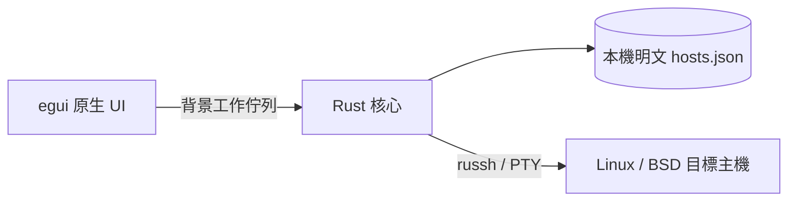

# MISF Management Terminal：全 Rust 原生桌面

> [!WARNING]
> **本專案仍處於開發階段，請勿用於正式環境。**
> 相關安全保護機制尚未完善；密碼、SSH 私鑰及其他敏感連線資料目前皆以明文儲存。

單一桌面 App，以 eframe／egui 繪製原生視窗，直接呼叫同一個執行檔內的 Rust 核心。沒有 JavaFX、管理伺服器、TOKEN、遠端資料庫或 HTTP 服務。此版移除 PIN、Vault、加密檔案與 keyslot。

## 已實作

主機新增、編輯、刪除、搜尋；保存位址、埠、SSH 帳號、系統類型與備註。支援 SSH 密碼認證，或匯入 OpenSSH／PEM 私鑰與私鑰密語。程式自帶 russh，不執行系統 ssh，不讀取本機 SSH config、known_hosts、agent 或系統私鑰。

首次連線先取得 SHA-256 指紋，使用者確認後才提交認證。指紋變更即阻擋連線，可明確重新核對。變更目標位址或埠時，會清除既存信任及檢查結果。

Linux APT 檢查先偵測 Linux 與 APT，root 直接執行 apt-get update，一般帳號透過 sudo 執行。可要求 PTY，sudo 密碼透過 channel 的 stdin 傳送，不放在命令列。索引更新成功後以固定英文 locale 列出待更新套件；只列清單，不安裝或升級。索引更新失敗不讀取舊套件清單。BSD 支援主機保存與 SSH 連線測試，此版不提供 BSD 套件檢查。

## 本機儲存與背景工作

預設儲存於使用者目錄 `.misf-management/hosts.json`，以 MISF_DATA_DIR 可更改位置。SSH 密碼、sudo 密碼、私鑰、密語與檢查結果都以明文保存；UI 顯示提示及路徑。寫入使用檔案鎖與暫存檔原子替換；損壞或不支援版本的既存檔案不會被自動覆寫。

名稱修正後，首次啟動會複製舊版 `.msif-management/hosts.json` 至新目錄，保留原檔並避免覆寫新目錄既有資料。明確設定 MISF_DATA_DIR 時使用指定路徑，不自動遷移其他目錄。

UI 經工作佇列交給背景執行緒與 Tokio runtime 執行 SSH／磁碟操作，進度與結果回傳畫面，避免介面卡住。執行期間停用衝突操作。關閉程式會終止本機程序及連線，不能保證中止遠端已開始的 APT 程序。

## 驗證與限制

測試 SSH 伺服器在 loopback 驗證密碼／私鑰、指紋變更阻擋、PTY、拆包 sudo 提示、APT 失敗、BSD 及儲存流程。原生 UI 以開發用擷取功能驗證排版與中文顯示。

目前只保存最近一次檢查，不支援任意命令、互動終端、排程或 Ansible。Windows 已建置驗證，其他作業系統需在對應環境建置及驗證。檔案加密與多金鑰若日後重新加入，需另設儲存遷移。
