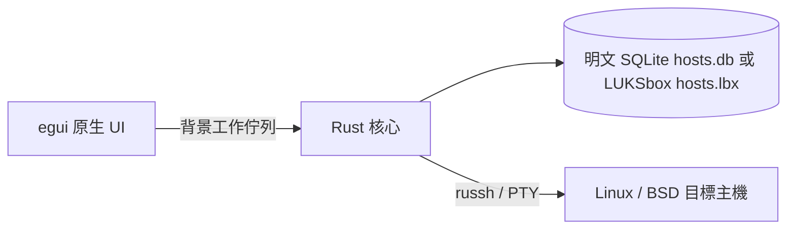

# MISF Management Terminal：全 Rust 原生桌面

> [!WARNING]
> **本專案仍處於開發階段，請勿用於正式環境。**
> 相關安全保護機制尚未完善。

單一桌面 App，以 eframe／egui 繪製原生視窗，直接呼叫同一個執行檔內的 Rust 核心。沒有 JavaFX、管理伺服器、TOKEN、遠端資料庫或 HTTP 服務。提供明文 JSON 或可選的 LUKSbox 加密主機庫；加密模式啟動時需使用已註冊密碼或 Passkey 解鎖。

## 已實作

主機新增、編輯、刪除、搜尋；保存位址、埠、SSH 帳號、系統類型與備註。支援 SSH 密碼認證，或匯入 OpenSSH／PEM 私鑰與私鑰密語。程式自帶 russh，不執行系統 ssh，不讀取本機 SSH config、known_hosts、agent 或系統私鑰。

首次連線先取得 SHA-256 指紋，使用者確認後才提交認證。指紋變更即阻擋連線，可明確重新核對。變更目標位址或埠時，會清除既存信任及檢查結果。

每次檢查或升級先以 `sh -c` 執行偵測命令：`uname -s`／`uname -r`、讀取 `/etc/os-release` 的 NAME／VERSION_ID（Debian 的「GNU/Linux」省略，例如「Debian 13」「Ubuntu 26.04」），並列出可用的 apt、dnf、yum 與已初始化的 pkg。Linux 依 APT → DNF → YUM 選擇，FreeBSD／DragonFly 使用 pkg，其餘系統標為不支援。偵測結果（`distro`、`package_manager`）寫入檢查結果與主機紀錄；測試連線也會更新，儲存主機時一律沿用伺服器端舊值，位址或埠變更則清除。舊紀錄沒有 `package_manager` 但曾成功檢查者視為 APT。主機已有紀錄時，偵測結果不同即失敗且不執行套件命令，因為確認視窗顯示的是紀錄中的命令。

APT 檢查：root 直接執行 apt-get update，一般帳號透過 sudo 執行。可要求 PTY，sudo 密碼透過 channel 的 stdin 傳送，不放在命令列。APT 更新使用 `-q=1` 紀錄模式，停用會持續重畫的下載進度並保留來源、摘要與錯誤。SSH 收到的 CRLF 統一為換行，單獨 CR 也另起一行以保留診斷訊息；ANSI 顏色／游標及終端控制字串不進入儲存結果。執行輸出以可選取的等寬文字呈現，保留換行並支援水平與垂直捲動，顯示舊紀錄時也清理控制碼。已被舊版串接的歷史進度無法還原，需重新執行檢查。索引更新成功後以固定英文 locale 列出待更新套件；檢查只列清單。索引更新失敗不讀取舊套件清單。

DNF／YUM 以 `makecache` 更新中繼資料（含 `Error:`、`Failed to download metadata` 或 `Ignoring repositories` 即視為失敗），再以 sudo 執行 `check-update -C` 並接著輸出 `rpm -qa` 的已安裝版本；退出碼 0／100 為成功，`name.arch evr repo` 依空白重新分組，以容忍 yum 換行，`Obsoleting` 之後忽略。升級為 `-y upgrade`。FreeBSD pkg 以 `pkg update` 更新目錄，`pkg version -URv -l '<'` 列出需更新的套件（不需 sudo），升級為 `pkg upgrade -y`。

APT 升級在相同流程後追加 `apt-get -y upgrade`：一般帳號以 `sudo -S -- env DEBIAN_FRONTEND=noninteractive NEEDRESTART_MODE=l …` 執行，避免 sudo 重設環境變數；dpkg 使用 `--force-confdef --force-confold` 保留既有設定檔。每個 channel 各自偵測 sudo 提示並最多送出一次密碼。升級前後各讀一次待更新清單，`CheckResult.upgraded` 保存升級前有、升級後消失的套件，`packages` 保存剩餘（被保留）的套件，`operation` 區分 check／upgrade；舊紀錄缺少這些欄位時視為檢查。索引更新失敗不會開始升級；升級輸出含 `E:` 或非零退出碼即為失敗，並提示遠端可能已部分升級。連線每 30 秒送 keepalive，避免長時間沉默的 dpkg trigger 觸發閒置斷線。

批次作業 `{"action":"batch","operation":"check"|"upgrade","ids":[…]}` 去除重複 ID 後讀取主機快照，以 Tokio JoinSet 與 Semaphore 最多 8 台並行執行同一流程，每台完成回報 `批次作業進度 n/total`；全部結束後一次寫回各主機結果。任何 ID 不存在，或主機的套件管理器未偵測、彼此不同，則整批拒絕；單台連線、指紋或 sudo 失敗只記在該主機結果。Session 對批次中每台主機各寫一筆開始與結果日誌；debug 模式要求所有主機皆為 loopback IP。介面依套件管理器分組，一次只允許勾選同一組中已確認指紋的主機，表格依待更新數量由多到少排序；升級前一律顯示主機清單、該套件管理器的實際命令與風險並要求勾選確認。

## 本機儲存與背景工作

左上角「設定」按鈕開啟集中管理語言與外觀的視窗，並顯示版本資訊：MISF 程式版本（取自 Cargo 套件版本，目前 0.1.0）、主機庫格式（SQLite 或尚未轉換的舊版 JSON，以及是否 LUKSbox 加密）與資料庫結構版本（讀自檔頭 `user_version`）；格式為 JSON 時下方顯示「轉換為 SQLite 資料庫」按鈕，送出 `convert_storage` 寫回一次未變更的主機資料，容器內的 `/hosts.json` 便在同一次提交中換成 SQLite，不必等下一次編輯；這些值隨 `list` 回應更新，鎖定時不顯示。介面語系由 `app/locales/zh-tw.json`／`en-us.json` 提供，內嵌進執行檔，透過穩定 key 與命名參數即時切換。`app/src/theme.rs` 統一管理淺色／深色配色及系統主題選項，涵蓋卡片、輸入框、對話框與警告。非敏感偏好以獨立、未加密的 `ui-settings.json` 保存，不進入主機資料／加密容器，因此鎖定主機庫也可讀取語言及外觀；使用暫存檔原子替換，寫入失敗會顯示錯誤。

預設儲存於使用者目錄 `.misf-management/hosts.db`，以 MISF_DATA_DIR 可更改位置。主機資料使用 SQLite（靜態連結 bundled SQLite 3.54.1，`core/src/sqlite.rs`），資料表為 `hosts`、`check_results`、`packages`（STRICT，以 position 保留順序），v2 起另有 `key_slots`（LUKSbox 金鑰槽名稱）與 `hosts.manager_choice`（使用者指定的套件管理器，空字串為自動偵測）。檔頭 `application_id` 固定為 `0x4D495346`（"MISF"），`user_version` 是結構版本槽；`MIGRATIONS[n]` 把 vN 升到 vN+1，只能追加、不得修改已發佈的版本。

開檔前先拒絕 WAL：資料庫旁有 `-wal`／`-shm`，或檔頭讀寫格式位元組不是 rollback journal，就不交給 SQLite，避免 SQLite 在任何檢查之前重放 WAL 或改寫檔頭。每次開啟先強化連線：DEFENSIVE、關閉 trusted_schema、停用 trigger／view、ATTACH 上限 0、rollback journal（不用 WAL）、secure_delete、temp_store=MEMORY、mmap_size=0、cell_size_check；未編入 load_extension。接著執行 quick_check，核對 application_id 與版本，再把 sqlite_schema 與同版本遷移在記憶體重建的參考結構逐列比對；多出的 trigger、view、index 或改過的欄位定義都會拒絕。版本較新時拒絕開啟，不降級寫入；版本較舊時明文檔先複製為 `hosts.v<N>.bak.db`，再於單一交易執行遷移並更新 user_version。遷移每一步一個檔案，放在 `core/src/db_upgrade/vN_vM.rs`，依序串接，所以任何舊版本都會逐步升到目前版本（例如 v1 會依序執行 v1→v2、v2→v3…）；新增版本只要加一個檔案並附加到 `MIGRATIONS`，已發布的步驟不得修改。加密容器解鎖後若資料庫是舊版本，主機庫維持鎖定（`pending_upgrade`），先詢問使用者：同意才送出 `vault_upgrade` 寫回目前版本並開啟，取消則送出 `vault_upgrade_cancel` 關閉容器，檔案保持原版本。所有 SQL 為固定語句與綁定參數。

明文模式仍以 `hosts.lock` 跨程序互斥，讀取時整份載入、寫入時於單一交易取代全部列；SQLite busy_timeout 為 5 秒。新資料庫先在同目錄暫存檔建立，必要時匯入同目錄舊版 `hosts.json`（原檔不變），再以不覆寫方式移入定位；損壞的 JSON 不會產生資料庫。損壞或不支援版本的既存檔案不會被自動覆寫。

使用者可將主機庫轉成同目錄 `hosts.lbx`，內含加密的 SQLite 映像 `/hosts.db`：每次儲存在記憶體建立全新資料庫並序列化（已刪除的列不會殘留），寫入新 inode 後以 rename 於單一中繼資料提交取代；讀取時以 sqlite3_deserialize 在記憶體開啟並套用與檔案相同的檢查與遷移。舊容器的 `/hosts.json` 可直接讀取，下一次儲存時在同一提交中移除。使用 LUKSbox v0.6.1 固定版本的 core／format／VFS，以 AES-256-GCM-SIV 與 Argon2id 保存內容及中繼資料，無須掛載磁碟。轉換驗證後原明文檔先保留。GUI 每次啟動與解鎖後檢查目前資料目錄 hosts.db 及舊版 hosts.json，解鎖後以確認視窗顯示完整路徑並詢問刪除；保留不會停用下次詢問。核心 vault_delete_plaintext 要求已解鎖、明確確認及完全相同的絕對路徑，先讀取驗證容器、取得明文資料鎖，再拒絕非一般檔案／symlink／Windows reparse point，最後只刪除該檔（hosts.db 時連同 `-journal`）；hosts.db 刪除後若仍有舊版 hosts.json，會接著詢問。設定、日誌及其他副本不在刪除範圍，這不是安全抹除。詢問、保留與刪除結果皆使用固定事件寫入日誌，不記錄路徑或內容。加密模式鎖定時不提供主機操作，也禁止回退明文；支援手動鎖定、密碼與 Passkey 合計最多 8 槽、指定槽撤銷與加密備份。儲存狀態和解鎖金鑰保存在背景 worker 的 StorageSession，非每次請求重建。

`core/src/passkey.rs` 使用相同上游的 FIDO2 crate：Windows 透過 webauthn.dll 要求使用者驗證並選擇 Hello／外接安全金鑰；Linux 透過 libfido2 與當次 PIN 操作 CTAP2 裝置。只接入 `Fido2HmacSecret` 包裝槽，不使用直接派生主金鑰槽。註冊後兩次讀取 PRF 確認一致，才追加並同步 header；公開 credential ID 與 salt 隨槽保存，PIN／PRF 不落地。解鎖從公開 header 取候選槽後取得 PRF，再由 Container 驗證容器；不存在相符金鑰或驗證失敗均禁止開啟。撤銷先檢查槽存在且不是最後一個槽，再同步 header。撤銷不代表使舊容器或已解鎖工作階段失效。

Windows 的原生呼叫由 `core/src/windows_passkey.rs` 維護，透過同一個 Fido2Authenticator trait 與 LUKSbox 互通。每次 ceremony 建立合法 JSON 與 32-byte 隨機 challenge，依 OS API 能力選 options 版本，保持 UV Required；現代 API 使用 bEnablePrf，舊版使用 hmac-secret extension。原生輸出採 RAII 釋放，驗證回傳 credential 屬於請求的槽後才取 PRF，並立即放入 zeroizing 容器。原始 salt 旗標維持關閉，保留既有 V4 的 PRF 前綴轉換。原生參數錯誤與取消會分別呈現，版本資訊不含敏感值。

GUI 與 CLI 經 `core/src/session.rs` 執行共用稽核與 debug 政策，再呼叫 StorageSession。`core/src/audit.rs` 只接受固定動作／結果列舉、可選的主機名稱和槽號，不接受原始請求或錯誤字串；以 JSONL、程序內互斥與跨程序檔案鎖追加 UTC 每日日誌，並同步磁碟。日誌與偏好均獨立於加密主機庫；日誌沒有防竄改或自動清理機制。開始紀錄無法寫入時拒絕背景操作，完成結果無法記錄時明確報告狀態可能已改變。

`RuntimePaths` 在啟動時解析 `--debug.dir`，以明確路徑注入偏好與 worker，不修改程序環境。debug 分支不呼叫預設主機庫遷移；優先於 MISF_DATA_DIR，失敗不回退。UI 顯示 DEBUG，背景政策只允許 loopback IP 的 SSH、禁止真實 Passkey 操作，備份限測試目錄內。此模式請搭配測試資料；Passkey 自動測試使用 MockAuthenticator，並透過相同容器 API 驗證解鎖與撤銷。

只有明確指定 `--debug.allow-passkey` 且同時指定 debug 目錄，才開放實體驗證器操作，並顯示硬體啟用提示及記錄對應日誌。該開關不解除 SSH 或備份限制；缺少目錄或重複開關均拒絕啟動。

預設資料目錄為使用者目錄下的 `.misf-management`；明確設定 MISF_DATA_DIR 時使用指定路徑。

UI 經工作佇列交給背景執行緒與 Tokio runtime 執行 SSH／磁碟操作，進度與結果回傳畫面，避免介面卡住。執行期間停用衝突操作。關閉程式會終止本機程序及連線，不能保證中止遠端已開始的套件程序。

## 驗證與限制

測試 SSH 伺服器在 loopback 驗證密碼／私鑰、指紋變更阻擋、PTY、拆包 sudo 提示、系統偵測、APT 與 DNF 檢查／升級、套件管理器不符、混合批次、APT 失敗、不支援系統及儲存流程。原生 UI 以開發用擷取功能驗證排版與中文顯示。

目前只保存最近一次檢查或升級，不支援 full-upgrade、任意命令、互動終端、排程、滾動升級順序或 Ansible。Windows 已建置驗證，其他作業系統需在對應環境建置及驗證。Passkey 已通過模擬驗證器測試，仍需實體裝置驗證。尚未支援主金鑰輪替、TPM 或閒置自動鎖定；詳細取捨見 [LUKSbox 整合評估](luksbox-evaluation.md)。FIDO2 依賴的本機相容性修改、版本與仍存在的 RSA 公告見 [依賴更新](dependency-updates.md)。
